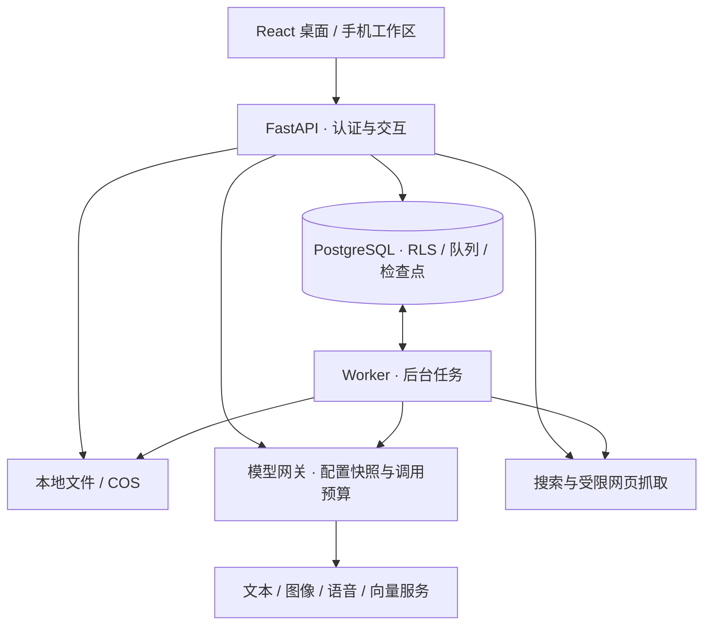

# 架构与数据流

[← 项目首页](../README.md) · [使用指南](USAGE.md) · [模型配置](CONFIGURATION.md) · [开发指南](DEVELOPMENT.md)

ItemTalk 将设备识别、公共资料构建和用户私有问答分开处理。API 接收交互，Worker 执行后台任务；二者共享 PostgreSQL 与持久文件存储，使用独立受限数据库身份。

## 系统组成



| 位置                                                      | 职责                                       |
| --------------------------------------------------------- | ------------------------------------------ |
| [`backend/app/main.py`](../backend/app/main.py)           | HTTP API、能力、管理与流式接口             |
| [`services/`](../backend/app/services/)                   | 识别、资料、问答、记忆、说明书、引导与清理 |
| [`adapters.py`](../backend/app/adapters.py)               | 模型/搜索适配与调用计量                    |
| [`model_responses.py`](../backend/app/model_responses.py) | Responses 请求与输出适配                   |
| [`model_configs.py`](../backend/app/model_configs.py)     | 管理员配置测试、加密保存与用途约束         |
| [`operations.py`](../backend/app/operations.py)           | 运行配置快照、额度和受控指标               |
| [`worker.py`](../backend/app/worker.py)                   | 任务领取、执行与清理循环                   |

## 识别：外观、候选与确认

1. 视觉模型同时接收照片与文字线索，提取可见特征和可能类别。
2. 结合产品页面、厂家目录或可用的原生图搜图结果比对候选。
3. 给用户候选列表、匹配点、差异和补拍建议，支持排除与多轮补充。
4. 用户确认后创建个人设备实例；候选身份仍与来源核验状态分开。

纯外观猜测不会发布为官方身份。地区和硬件修订独立核验，制造地、年份与固件号不能代替。图像搜索提供检索线索，视觉模型负责理解和比较，二者都不直接等于官方资料核验。

## 资料：下载、解析与索引

```text
完整型号 / 已登记来源 / 搜索
             ↓
官方产品页、支持页与说明书链接发现
             ↓
公网与重定向检查 → 下载 → 版本与型号适用性核验
             ↓
普通正文提取 / 扫描页图像转写（保留页码与缓存）
             ↓
官方知识发布，或独立的第三方补充索引
             ↓
分片 → 分批向量化 → 检索与引用
```

官方知识要求来源、型号和文档版本核验通过。第三方补充索引单独保存来源等级、冻结正文与原页依据；复用必须检查适用性和完整性。资料别名复用不合并用户设备、私有会话或来源信任等级。

扫描页复用当前图像模型，每份最多 20 个扫描页；单页预算和整份 10 分钟预算分开。成功页面按文档与配置记录，可在重试时复用。文字层 PDF 不因页数多就全部调用 OCR。

长手册按批次保存向量，失败重试复用一致的已完成结果，全部批次完成才标记就绪；不能通过截断长手册冒充完整构建。查询与文档必须使用一致的向量模型、修订和维度。

## 问答：按证据分层

| 顺序 | 处理                                         | 最终标识                      |
| ---- | -------------------------------------------- | ----------------------------- |
| 1    | 当前型号官方知识的向量 / trigram 混合检索    | 已核验资料引用                |
| 2    | 第三方补充索引与实时网页研究，核验实际引用   | 联网 / 补充资料，区分来源等级 |
| 3    | 证据不足时，独立调用文本模型生成当前型号参考 | 模型推测 · 未经资料核验       |

照片与文字在模型输入中组合，照片是观察线索；资料片段另附来源信息。有引用的答案通过支持性核验，发布前重新检查来源及引用状态。索引不足或可恢复错误会继续尝试联网，关键词本身不决定第三方资料是否可回答。

模型参考使用独立生成与来源声明语义检查，列出尚未确认信息，清空证据引用，不能当成联网结果缓存。历史结构兼容 `answerBasis=general`，结合 `webLookup.lookupMode=model_reference` 区分新模型参考与旧通用建议。

明确危险请求、身份冲突、取消和总截止时间仍可阻止回答。问答允许的未核验参考不扩展为操作引导的已核验步骤。

## 私有状态与安全边界

- **身份与隔离**：API/Worker 非超级用户、无 BYPASSRLS；私有表强制 RLS，事务绑定已验证用户或任务所有者。管理员身份不授予读取私人聊天、照片和记忆的权限。
- **记忆**：模型只提取待确认候选；确认、有效期和实例范围决定是否使用，不将私人内容写入公共知识缺口。
- **引导**：DeepAgents 负责受限规划，LangGraph 的等待节点与业务状态在同一 PostgreSQL 事务内保存；本人可暂停恢复，终态检查点有界清理。
- **文件**：签名上传与确认分开，私有照片不进入公共资料；孤儿对象、旧签名和删除对象由 Worker 按生命周期处理。
- **删除**：先撤销访问与任务，再按依赖分批删除。仍被引用的对象和公共知识不随个人实例一并清除。
- **来源与网络**：抓取逐跳检查公网地址和 TLS；注册域名或登记 URL 不等于正文已核验，撤销来源停止新检索。

## 运行配置与可观测性

管理员分别启用四类模型配置，新任务捕获配置快照；不把切换注入已开始的运行。网站日额度、供应商余额、超时与重试分别管理。价格估算和未知 usage 保留原语义，不伪造零费用。

指标和审计只记录受控字段，不保存用户问题、回答、照片地址或密钥。公共资料缓存与用户私有查询缓存分开管理；模型推测不是可复用的网页证据。

具体配置见[模型与服务配置](CONFIGURATION.md)，发布边界见[维护手册](../infra/MAINTENANCE.md)。
